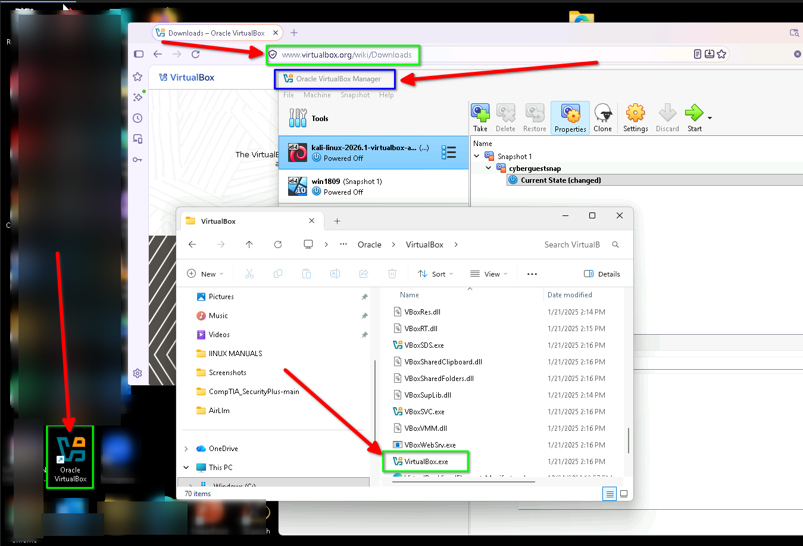
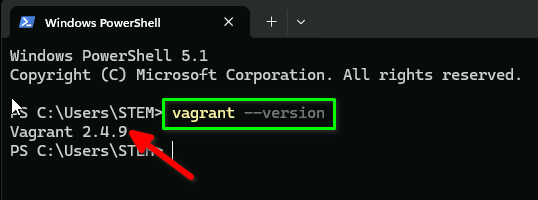
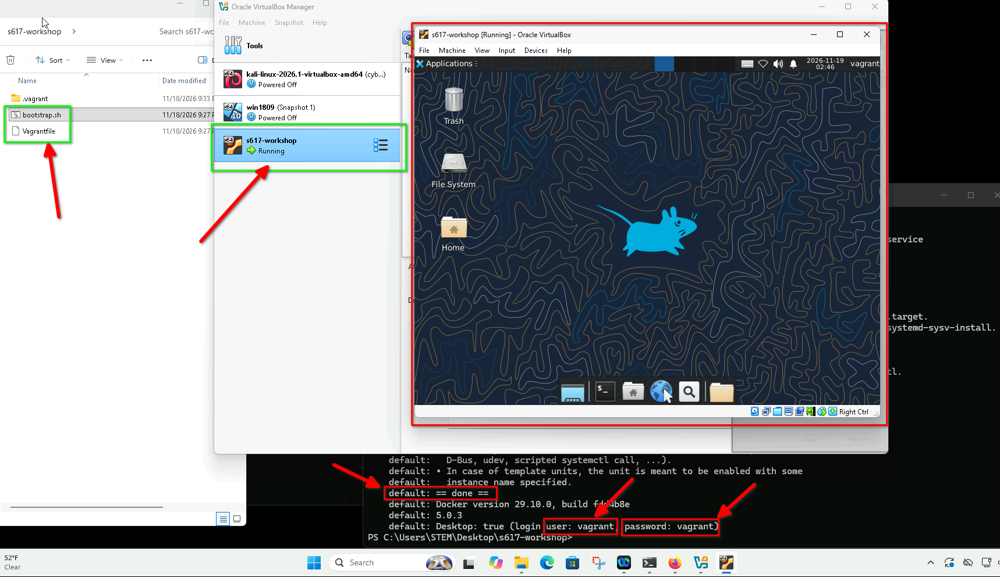
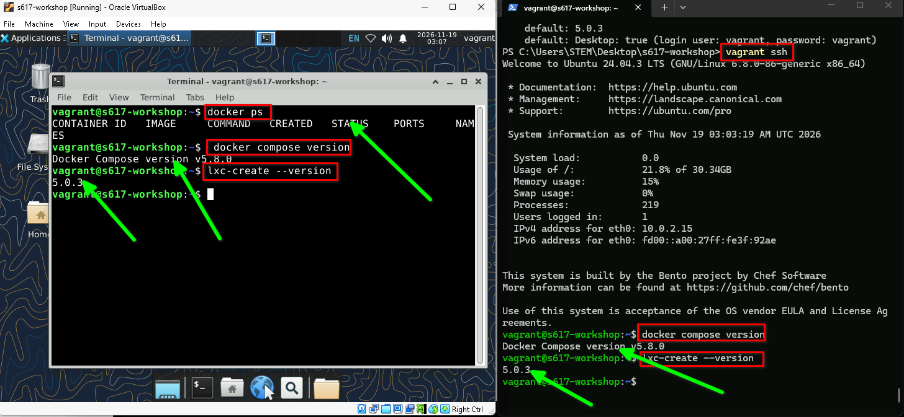
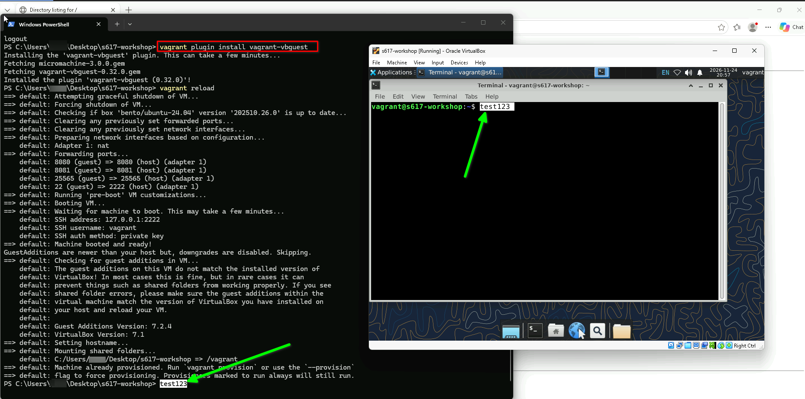
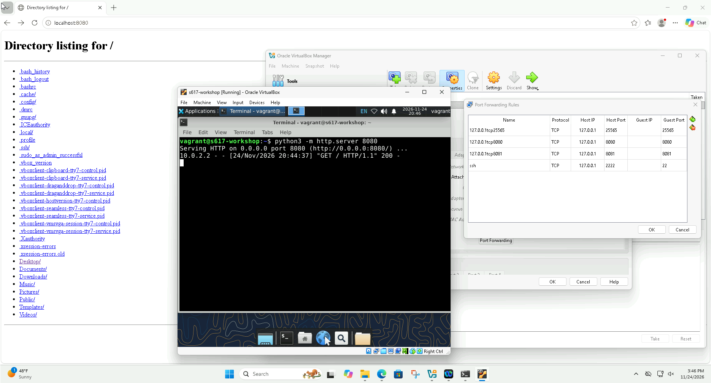

# SETUP - Install the tools and run the S617 workshop VM

**Cybersecurity Lab Room S617 - Virtualization & Containerization**

This is the hands-on companion to **Lab 00 (Foundations)**. It walks you through installing the tools and bringing up the workshop VM using the two files in this folder:

- **`Vagrantfile`** - the recipe that defines the VM.
- **`bootstrap.sh`** - the provisioning script that installs Docker, LXC, and the XFCE desktop inside it.

> **You install only two programs: VirtualBox and Vagrant.** Everything else - the Linux VM, its XFCE desktop, Docker, and LXC - is built for you by `vagrant up`. You do **not** install Docker, Ansible, or Linux on your own machine.

**Apple Silicon Macs (M1/M2/M3/M4):** VirtualBox cannot run this x86 VM on your hardware. Use the remote lab option your instructor provides instead of this guide. (Windows and Intel Macs: follow along.)

---

## Step 1 - Install VirtualBox if it is not installed already (the provider)
$\color{red}{\text{skip that step if you are in the S617 cybersecurity lab room or you have virtualbox already installed}}$

VirtualBox is the free hypervisor that actually runs the VM.

1. Go to **https://www.virtualbox.org/wiki/Downloads**.
2. Download the package for your OS:
   - **Windows:** "Windows hosts"
   - **Intel Mac:** "macOS / Intel hosts"
3. Run the installer, accept the defaults, and reboot if it asks.

> Troubleshoot: if virtualbox request dependence and finished premature run PowerShell or Terminal as Administrator.
> ```
>  winget install -e --id Microsoft.VC++2015-2022Redistributable.x64
>  winget install -e --id Oracle.VirtualBox
>   ```
> 
4. Verify from a terminal (PowerShell on Windows, Terminal on Mac):
   ```
   VBoxManage --version
   ```
   If that prints a version number, you're good. On Windows, if the command
   isn't found, VBoxManage lives at
   `C:\Program Files\Oracle\VirtualBox\VBoxManage.exe`.

> 

---

## Step 2 - Install Vagrant (the orchestrator)
$\color{red}{\text{skip that step if you are in the S617 cybersecurity lab room or you have vagrant already installed}}$

1. Go to **https://developer.hashicorp.com/vagrant/install**.
2. Download the **64-bit (AMD64)** build for your OS.
   > **Important (Windows):** install the **64-bit** version, not 32-bit. The 32-bit build on 64-bit Windows causes a confusing "box doesn't support the provider" error later.
3. Run the installer and accept the defaults. Reboot if prompted.
4. Verify:
   ```
   vagrant --version
   ```
   You want a recent version (2.4.x or newer). If yours is old, uninstall it and install the current 64-bit build - newer boxes need it.

>  

---

## Step 3 - Put the lab files in a folder

Get **`Vagrantfile`** and **`bootstrap.sh`** (from this folder in the S617 repo, or as provided by your instructor) and place **both in the same empty folder**,
for example:

- Windows: `C:\Users\<you>\Desktop\s617-workshop\`
- Mac: `~/s617-workshop/`

Open a terminal **in that folder**:
- Windows: Shift-right-click the folder -> "Open PowerShell window here", or
  `cd C:\Users\<you>\Desktop\s617-workshop`
- Mac: `cd ~/s617-workshop`

---

## Step 4 - READ the files before you run them

This is a security habit, not a formality: `vagrant up` runs `bootstrap.sh` as **root inside the VM**, so you should know what it does first.

Open both files in a text editor and confirm you can answer:

- **`Vagrantfile`** - which base box does it use (`config.vm.box`)? How much RAM and CPU? What does the provisioner run?
- **`bootstrap.sh`** - what does it install (Docker, LXC, the XFCE desktop), and what does each step do? Notice it's heavily commented for this reason.

> *"Never run what you haven't read."* You'll apply this to every lab in the course.

---

## Step 5 - Build the VM with one command
## open a terminal or a powershell in the phisecal computer
cd ~/Desktop
git clone https://github.com/CyberLab-S617/s617.git
cd ~/Desktop/s617/labs/00virtualization
vagrant up  ## Go grabe a cofee that might take some time 
## after you see "default: == done ==" run the vagrant halt to graceful shutdown the new vm
vagrant halt
## then run it again to boot to the vm desktop user interface
vagrant up
```

What happens (first run takes several minutes - longer, because it builds a desktop):

1. Vagrant downloads the small Ubuntu base box (once; it's cached afterward).
2. It creates and boots the VM in VirtualBox, and a **VirtualBox window opens**.
3. It runs `bootstrap.sh` inside, installing Docker, LXC, and the XFCE desktop.

When it finishes, the VirtualBox window shows a **graphical XFCE desktop** - that window *is* your VM. (If it asks for a login, the user is `vagrant` and the password is `vagrant`.)

> **This is the visual you'll rely on all course:** the VirtualBox **window with a desktop** = the **VM**. A **bare shell with a different prompt** that you open later (with `docker run` or `lxc`) = a **container** running inside that VM. Window = machine; prompt = process.

> 
### If you see "The box you're attempting to add doesn't support the provider"

This is a known issue caused by the Vagrant registry's architecture handling (it's being retired). The fix is two parts, and the `Vagrantfile` in this folder already includes the second:

1. Add the box explicitly with the architecture flag:
   ```
   vagrant box add bento/ubuntu-24.04 --provider virtualbox --architecture amd64
   ```
2. Confirm the `Vagrantfile` contains this line (it does):
   ```ruby
   config.vm.box_architecture = "amd64"
   ```
3. Run `vagrant up` again.

> `amd64` is the 64-bit x86 architecture - it is **not** AMD-only. It is the
> correct choice on Intel CPUs too.

If `vagrant up` still fails on an older Vagrant, upgrade Vagrant to the current
**64-bit** build (Step 2) and retry.

---

## Step 6 - Verify the tools

You can work two ways, and it's worth knowing both:

- **In the desktop:** in the VirtualBox window, open **XFCE Terminal** from the
  applications menu. That shell is "inside the VM."
- **Over SSH (often easier to copy/paste):** from the folder on your host, run `vagrant ssh`.

Either way, confirm the tools installed correctly:

```bash
docker ps                 # Docker is running (empty list is fine)
docker compose version    # Compose v2 plugin
lxc-create --version      # LXC
```

You should see versions print with no errors. (From an SSH session, type `exit` to leave the VM - it keeps running.)

> 
---

## Copy & paste between your computer and the VM

So you can copy commands from the lab pages (on GitHub, in your host browser) and paste them into the VM, the `Vagrantfile` turns on VirtualBox's **shared clipboard**. Two ways to work:

- **Into the VM window (desktop):** copy on your host (Ctrl+C / Cmd+C), click into the XFCE Terminal in the VirtualBox window, and paste. In a Linux terminal, paste is **Ctrl+Shift+V** (or right-click -> Paste).
- **Into an SSH session (often easiest):** run `vagrant ssh` from your host terminal (PowerShell/Terminal). Because that window is on your host, paste works natively there - keep the GitHub page open beside it and paste away.

> **If clipboard sharing doesn't work in the VM window** (occasionally the Guest Additions version doesn't match your VirtualBox), install the helper plugin once and reload:
> ```
> vagrant plugin install vagrant-vbguest
> vagrant reload
> ```
> This rebuilds the Guest Additions "agent" to match your VirtualBox. The `vagrant ssh` method above always works regardless.

> 

---

## Opening the running services in your browser

Later labs start web services on ports **inside** the VM (a web app and a browser game in Lab 02, the vulnerable app in Lab 03). The `Vagrantfile` **forwards** those ports to your own computer, so when a lab has a service running you open it in **your own computer's browser**.

> The VM has **no GUI browser installed** - only `curl`/`wget` to check a page from inside the VM. Use **your host browser** for anything visual.

| Service (which lab) | Open in your host browser |
|---|---|
| Web app you build (Lab 02) | `http://localhost:8080` |
| Game server (Lab 02) | `http://localhost:3001` |
| Vulnerable app (Lab 03) | `http://localhost:8081` |

If your computer already uses one of these ports, Vagrant picks a free one and prints it during `vagrant up` - use that number instead. The forwards are bound to your machine only (`127.0.0.1`), not your whole network.

> **Note:** your host can't `ping` the VM with this setup - NAT allows the forwarded ports but not ping. No lab needs ping.

> 

---

## Step 7 - Manage the VM

From the folder with the `Vagrantfile`:

```
vagrant halt       # shut the VM down (keeps it; faster to start next time)
vagrant up         # start it again
vagrant reload     # restart, re-reading the Vagrantfile (after edits)
vagrant ssh        # log back in
vagrant destroy    # delete the VM entirely; `vagrant up` rebuilds it clean
vagrant status     # check what state it's in
```

> **Disposable by design:** if you ever break the environment, `vagrant destroy`
> then `vagrant up` gives you a fresh one in minutes.

---

## How VMs and containers are taught in this course

To keep the distinction crystal clear, the two technologies live in two different places:

- **VMs are taught with VirtualBox directly.** This workshop VM is itself a VM running in VirtualBox - a whole machine with its own kernel and a desktop, in its own window. When a lab needs to show "booting a fresh VM," you'll create a second VM in VirtualBox from a small ISO (e.g. Alpine). No nested virtualization, so it works reliably on any machine.
- **Containers are taught inside this VM** with Docker and LXC - lightweight, sharing the VM's kernel, shown as shells.

That's the whole mental model: **a VM is a VirtualBox window; a container is a shell inside one.**

## Optional - Run headless

The desktop is on by default so the VM is visually distinct. If you ever want a command-line-only build (faster, lighter), set `"INSTALL_DESKTOP" => "false"` in the `Vagrantfile`'s `env` block and `vagrant reload --provision`.

---

## Troubleshooting

| Symptom | Fix |
|---|---|
| `vagrant` or `VBoxManage` "not recognized" | Reopen the terminal after install; on Windows use the full path to `VBoxManage.exe`. |
| "doesn't support the provider" | Run the `vagrant box add ... --architecture amd64` command in Step 5; confirm `box_architecture = "amd64"` in the Vagrantfile; upgrade to 64-bit Vagrant if still failing. |
| No VirtualBox window appears | Make sure `vb.gui = true` is in the Vagrantfile, then `vagrant reload`. |
| Desktop asks for a password | User `vagrant`, password `vagrant` (the Vagrant default). |
| `docker ps` says "permission denied" | Open a new shell: `exit` then `vagrant ssh` again, so the `docker` group applies. |
| A forwarded page won't open in your browser | Make sure the lab's service is running (`docker compose ps`); if the port was in use, use the corrected port Vagrant printed at `vagrant up`. New port forwards need a `vagrant reload` to take effect. |
| `vagrant up` hangs on "Booting"/"SSH" | Make sure VirtualBox is installed and virtualization is enabled in your PC's BIOS/UEFI. |
| Everything is broken | `vagrant destroy -f` then `vagrant up` for a clean rebuild. |

---

### You're ready

Once `vagrant ssh` works and the tools verify, you've completed the setup that **every future S617 lab reuses**. Head to **Lab 01 - Namespaces & cgroups** to start building containers by hand.
