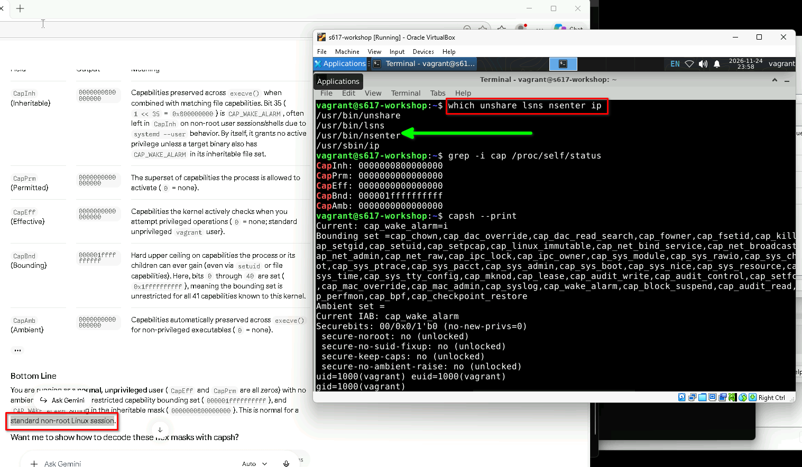
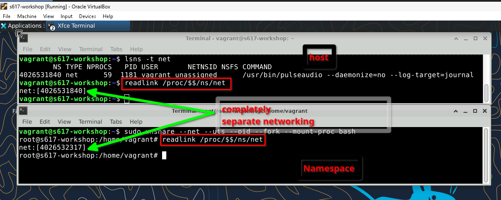
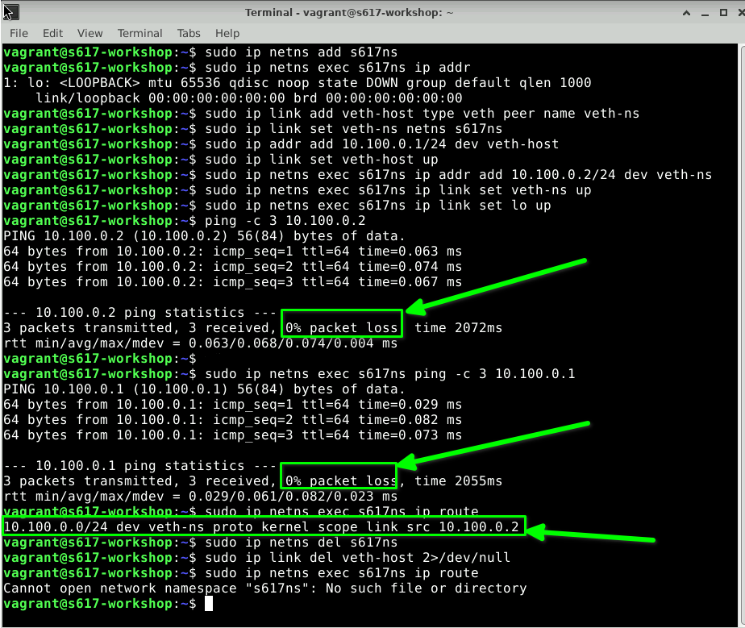
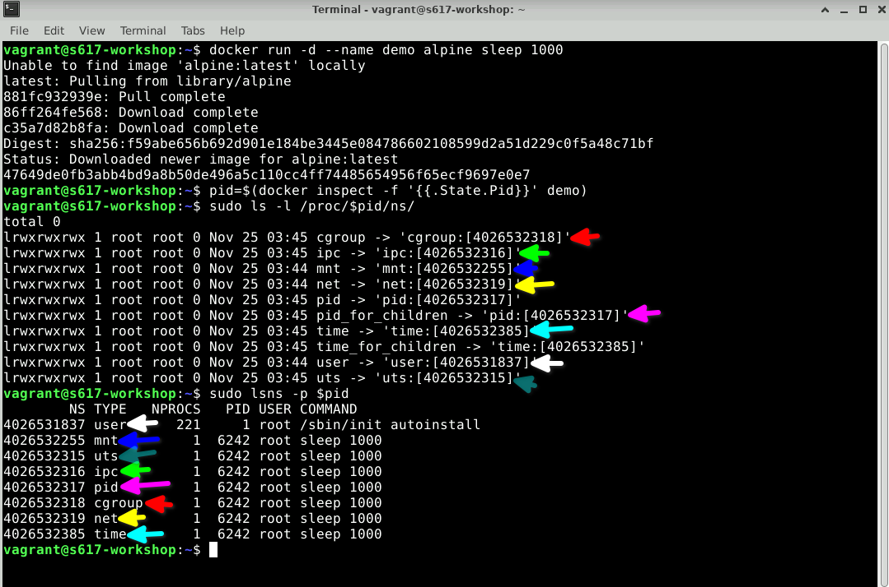

# Lab 01 - What a Container *Really* Is: Namespaces & cgroups

**Cybersecurity Lab Room S617 - Virtualization & Containerization**

If you get bored, watch that video then jump to Part 7.
https://youtu.be/dFGPOr_gInY?si=fButuCA5XzORZ-nn

> **Goal:** By the end of this lab you will be able to build a "container" by hand, with no Docker, using the same Linux kernel features Docker uses. You will see that a container is not a magic box - it's an ordinary process the kernel has been told to isolate. Then you'll see why that isolation can leak, which is the foundation for every container-escape finding in the field.
>
> **You are not expected to memorize commands.** You are expected to *read each command, predict what it will do, run it, and explain the result.*

---

## Before you start

- Boot the **S617 workshop VM** (`vagrant up`). It comes up as a desktop in a VirtualBox window - **that window is the VM.** Open a terminal in it (XFCE Terminal), or connect with `vagrant ssh`.

- **Keep the distinction in mind the whole time:** the VirtualBox window (a desktop, its own kernel) is the **VM**. Every "container" you build in this lab is a **shell inside that VM** - watch the prompt and hostname change when you enter one. 
> Window = machine; prompt = process.
- Everything here runs at a terminal inside the VM.
- Commands that change system state use `sudo`. Read them before you run them - that habit is the whole point of this course.

Check your tools are present:

```bash
which unshare lsns nsenter ip   # to confirming the tools are installed
# optional you can use "grep -i cap /proc/self/status"  or "capsh --print"  to get your process capabilities if the result is not clear please prompt your favorit AI "What does that mean?"
# 
```

> 

---

## Part 0 - The one idea that explains everything

There are two ways to run "another computer" inside your computer:

| | Virtual Machine | Container |
|---|---|---|
| Boots its own kernel? | **Yes** | **No - shares the host kernel** |
| What it really is | Emulated hardware running a full OS | A **process** with a restricted view of the system |
| Isolation boundary | The hypervisor (hardware-enforced) | Kernel features: **namespaces** + **cgroups** |
| Size / speed | GBs, boots in seconds-minutes | MBs, starts in milliseconds |
| If the kernel is exploited from inside | VM still contained | **Host is compromised** |

Everything in this lab is about that second column. A container is built from
two kernel features:

- **Namespaces** - control *what a process can see* (which processes, which network, which filesystem, which hostname...). Isolation of **view**.
- **cgroups** (control groups) - control *how much a process can use* (CPU, memory, PIDs...). Isolation of **resources**.

Docker, LXC, Podman, and Kubernetes are all just convenient front-ends that set up namespaces and cgroups for you. We'll do it by hand first so the magic disappears.

---

## Part 1 - Build a "container" by hand with `unshare`

`unshare` runs a program in **new namespaces**. Let's give a shell its own UTS namespace (hostname), PID namespace (process list), and mount namespace.

```bash
sudo unshare --uts --pid --mount --fork --mount-proc bash
```

You are now in a new shell. Try these **inside** it:

```bash
hostname container01        # change the hostname...
hostname                    # ...only this namespace sees the change
ps aux                      # look how FEW processes you can see
echo $$                     # your shell's PID - it's 1 (!)
```

> 

 - this is the "aha" moment, worth capturing._

**What just happened, line by line:**

- `--uts` gave you a private **hostname**. Changing it does *not* affect the host. 
Open a second terminal ( or `vagrant ssh` again) and run `hostname` there - still the old name. You changed a namespace, not the machine.
- `--pid --fork --mount-proc` gave you a private **process table**. Your shell is **PID 1** inside - the "init" of your container. `ps` shows almost nothing because you literally *cannot see* the host's processes. They still exist; your namespace just hides them.
- `--mount` gave you a private **mount namespace**, so `--mount-proc` could  re-mount `/proc` to reflect your new PID view without touching the host's.

> **This is a container.** Docker does exactly this, plus a few more namespaces and some cgroups. There is no "container engine" in the kernel - there are namespaces, and a process living inside them.

if you want to kill the container type `exit` then hit enter to leave. The namespaces are destroyed when the last process in them exits. Nothing was installed; nothing persists.

---

## Part 2 - Namespaces are real kernel objects you can see

Leave the container. On the host, every process advertises its namespaces as links in `/proc`:

```bash
ls -l /proc/$$/ns/
```

You'll see entries like `pid`, `net`, `mnt`, `uts`, `ipc`, `user`, `cgroup`,
each pointing at an inode number like `net:[4026531840]`. **Two processes are
"in the same namespace" if these inode numbers match.** That's the entire
mechanism.

List namespaces system-wide:

```bash
lsns                 # every namespace and which processes are in it
lsns -t net          # just network namespaces
```

> 

Now prove the isolation. Start a container again in the background and compare:

```bash
# Terminal A - start an isolated shell and note its net namespace
sudo unshare --net --uts --pid --fork --mount-proc bash
readlink /proc/$$/ns/net      # note this inode number

# Terminal B - on the host
readlink /proc/$$/ns/net      # DIFFERENT inode number
```

Different inode = different network namespace = the two shells have completely separate networking  (different interfaces, routing tables, firewall rules).
We'll exploit that in Part 5.

> 
---

## Part 3 - cgroups: capping what a process can *use*

Namespaces hide things. cgroups **limit** things. Without a cgroup, your "container" could use 100% of CPU and all the RAM - isolation of view is not isolation of resources.

Modern systems use **cgroups v2**, mounted at `/sys/fs/cgroup`.

```bash
cat /sys/fs/cgroup/cgroup.controllers    # what you can limit: cpu memory pids...
```

Create a cgroup that caps memory, and watch a greedy process get stopped:

```bash
# Create a cgroup and cap it to 50 MB of memory
sudo mkdir /sys/fs/cgroup/s617demo
echo 50 | sudo tee /sys/fs/cgroup/s617demo/memory.max

# Put THIS shell into the cgroup
echo $$ | sudo tee /sys/fs/cgroup/s617demo/cgroup.procs

# Now try to allocate 200 MB inside the capped shell:
python3 -c "x = bytearray(200*1024*1024); input()"
```

The process is **killed by the OOM (out-of-memory) killer** the moment it
crosses 50 MB - the kernel enforces the limit. Check the evidence:

```bash
sudo dmesg | tail        # look for an "oom-kill" / "Killed process" line
```

> 
> line._

Clean up (move your shell out first, then remove the group):

```bash
echo $$ | sudo tee /sys/fs/cgroup/cgroup.procs
sudo rmdir /sys/fs/cgroup/s617demo
```

> **Why a defender cares:** cgroups are what stop one compromised container from starving every other service on a host (a denial-of-service). "No memory limit set" is a real audit finding.

---

## Part 4 - `chroot` is not a security boundary

Before namespaces, people isolated filesystems with `chroot` (change the apparent root directory).You'll still see it in CTFs and legacy systems.
Here's why it's **not** containment on its own.

```bash
# busybox is a single binary that provides sh + many tools - perfect for a
# tiny fake root. Install it, then build the fake root:
sudo apt-get install -y busybox-static
mkdir -p ~/fakeroot/bin
cp $(which busybox) ~/fakeroot/bin/

# Enter the fake root - '/' now points at ~/fakeroot:
sudo chroot ~/fakeroot /bin/busybox sh
# inside: try `ls /`  - you only see the fake root. Then `exit`.
```

> 

`chroot` changes *where `/` points*, but it does **not** give a new PID, network,
or user namespace. A privileged process inside a `chroot` can often break back
out (the classic "double chroot escape"), and it can still see every process
and network interface on the host. **A mount namespace is the real version of
"a private filesystem view."** `chroot` is a convenience, not a jail.

> **Takeaway:** isolation is only as strong as the *weakest unshared resource*.
> `chroot` shares everything except the filesystem root - so it barely isolates
> at all.

---

## Part 5 - Network namespaces = network virtualization

This is the richest part for a security audience, because Docker's networking
*is* exactly this. A network namespace has its **own** interfaces, IP addresses,
routing table, and firewall rules.

```bash
# Create a named network namespace
sudo ip netns add s617ns

# It starts with ONLY a loopback, which is even down:
sudo ip netns exec s617ns ip addr
```

Now connect it to the host with a **veth pair** - a virtual cable with two ends:

```bash
# Create the virtual cable
sudo ip link add veth-host type veth peer name veth-ns

# Put one end inside the namespace
sudo ip link set veth-ns netns s617ns

# Configure the host end
sudo ip addr add 10.100.0.1/24 dev veth-host
sudo ip link set veth-host up

# Configure the namespace end
sudo ip netns exec s617ns ip addr add 10.100.0.2/24 dev veth-ns
sudo ip netns exec s617ns ip link set veth-ns up
sudo ip netns exec s617ns ip link set lo up

# Now ping across the "cable":
ping -c 3 10.100.0.2                              # host -> namespace
sudo ip netns exec s617ns ping -c 3 10.100.0.1    # namespace -> host
```

> 


You just built, by hand, what Docker builds every time you start a container on
a bridge network: an isolated network stack wired to the host through a veth
pair. Inspect it:

```bash
sudo ip netns exec s617ns ip route    # the namespace's OWN routing table
```

Clean up:

```bash
sudo ip netns del s617ns
sudo ip link del veth-host 2>/dev/null   # usually auto-removed with the netns
```

> **Why a defender cares:** container network segmentation lives here. A
> misconfigured network namespace (or `--network host`, which uses *no* new net
> namespace) means a container shares the host's network - an attacker who lands
> in it can reach everything the host can.

---

## Part 6 - Where isolation leaks: the escape mindset

Every container escape is the same sentence: **"a resource that should have
been isolated wasn't."** Now that you've built the isolation by hand, the
failures make sense. Read these - don't run attacks on anything you don't own.

1. **The shared kernel is the big one.** VMs each run their own kernel; all
   containers on a host share the *host's* kernel. A kernel exploit triggered
   from inside a container compromises the host and every other container. This
   is the fundamental reason a container is a weaker boundary than a VM.

2. **Privileged containers (`--privileged`, `--cap-add`).** Capabilities are
   slices of root's power. `CAP_SYS_ADMIN` is so broad it's nearly root. A
   container granted it can often remount filesystems or load modules and walk
   out. Check what you hold:
   ```bash
   grep Cap /proc/self/status      # then: capsh --decode=<CapEff value>
   ```

3. **The mounted Docker socket = instant host root.** If a container can reach
   `/var/run/docker.sock`, it can tell the host's Docker daemon to start a new
   container that mounts the host's `/` - game over. This is one of the most
   common real-world findings. (Recall from provisioning: *anyone in the
   `docker` group is effectively root on the host,* for the same reason.)

4. **`runC` CVE-2019-5736** - the canonical escape: a malicious container
   overwrote the host's container-runtime binary via `/proc/self/exe`, so the
   next `docker exec` ran attacker code **as host root**. The lesson: file
   descriptors and `/proc` are shared surfaces that must be handled carefully.

5. **VM escapes exist too, but are rare** (e.g., the "VENOM" virtual
   floppy-controller bug). Their rarity is *why* we say VMs are the stronger
   boundary - and why you choose a VM, not a container, to isolate genuinely
   untrusted or hostile code.

> **The spectrum, weakest to strongest:**
> namespaced process -> hardened container (seccomp, dropped caps, user
> namespaces) -> microVM (Firecracker/Kata) -> full VM.
> Pick the point on this line that matches how much you trust the workload.

---

## Part 7 - Now watch Docker do all of it at once

Everything above, Docker sets up in one command. Prove it:

```bash
# Start a container and look at its namespaces from the HOST
docker run -d --name demo alpine sleep 1000
pid=$(docker inspect -f '{{.State.Pid}}' demo)   # the container's PID on the host
sudo ls -l /proc/$pid/ns/                        # the same ns/ links from Part 2
sudo lsns -p $pid                                # the namespaces Docker created
```

> 

The container process is just a **normal process on the host** (`ps aux | grep
sleep` finds it) that has been placed into fresh namespaces and a cgroup -
exactly what you did by hand, automated. See its cgroup limits:

```bash
cat /sys/fs/cgroup/system.slice/docker-*/memory.max 2>/dev/null | head
```

Clean up:

```bash
docker rm -f demo
```

---

## Portfolio deliverable

Add a short write-up to your S617 portfolio that demonstrates understanding,
not just command-copying. Include:

1. The output of `ls -l /proc/$$/ns/` from inside an `unshare` container, and a
   one-paragraph explanation of what the inode numbers mean.
2. A screenshot or paste of your memory-cgroup OOM kill (Part 3), with the
   `dmesg` line, and one sentence on why a defender sets memory limits.
3. Your veth ping working across a network namespace (Part 5).
4. **In your own words:** "Why is mounting the Docker socket into a container
   dangerous?" (3-4 sentences.)

Commit it to your fork under `submissions/<your-username>/lab01/` and open a
pull request, following the repo's contribution steps.

---

### One-line summary to remember

> A container is a **process** the kernel has given a **private view**
> (namespaces) and a **resource budget** (cgroups). It shares the host kernel -
> which is why it's fast, and why, when it breaks out, the whole host is at
> risk.
