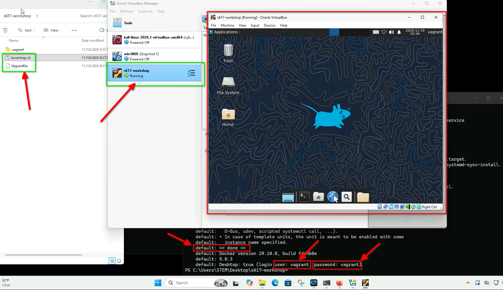
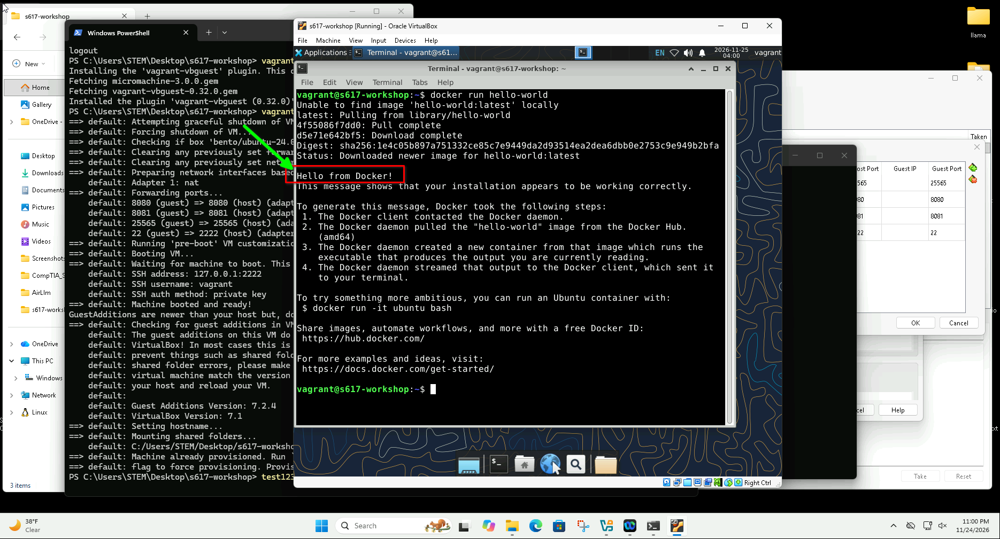
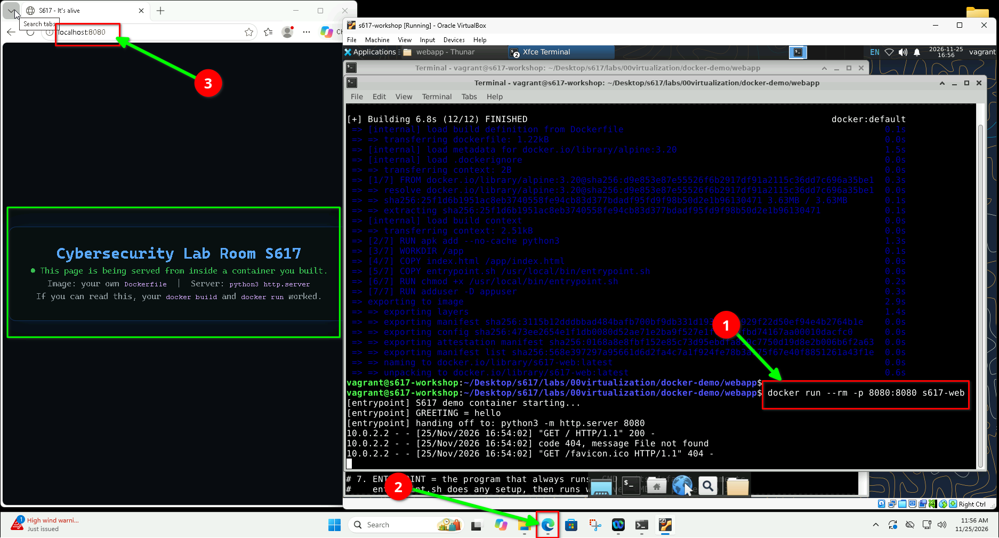
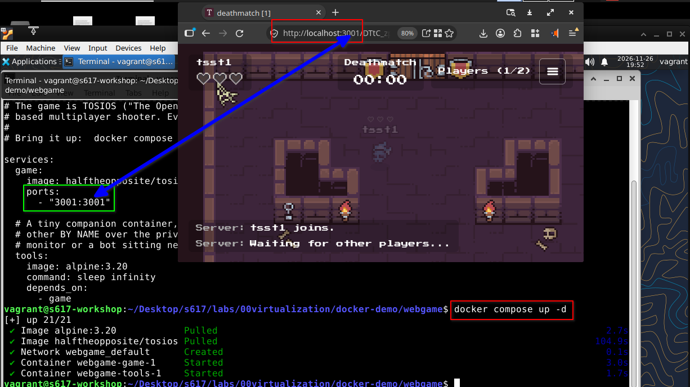
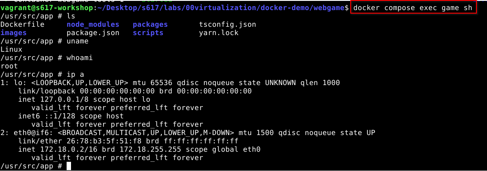

# Lab 02 - Docker & Docker Compose (build a web app, run a game server)

**Cybersecurity Lab Room S617 - Virtualization & Containerization**

> **Goal:** In Lab 01 you built a container *by hand* with namespaces and
> cgroups. Docker automates all of that. Here you'll run containers, **build
> your own image** from a `Dockerfile`, understand what `ENTRYPOINT` really
> does, and then use **Docker Compose** to spin up a real **browser game server**
> with a single command - the exact skill you'll use to bring up future labs.
>
> **Read every command before you run it.** Predict what it will do, run it,
> then check your prediction against the result.

>  


---

## Before you start

- Boot the **S617 workshop VM** (`vagrant up`) and open a terminal - XFCE
  Terminal in the desktop, or `vagrant ssh` from your host.
- Confirm Docker works:
  ```bash
  docker run hello-world
  ```
  If you see a "Hello from Docker!" message, you're ready.

> 

> **Reminder (Lab 00):** the VirtualBox window is the **VM**; each container you start below is a **process inside it**. Watch the shell prompt change when you step into a container.

---

## Part 1 - Images vs. containers

Two words people mix up:

- An **image** is the read-only template (the app + its files). Like a class.
- A **container** is a running instance of an image. Like an object.

Try it:

```bash
docker run -it --rm alpine sh      # start a container from the alpine image
```

You're now in a shell **inside** the container (the prompt changes to `/ #`).
Look around - it's a tiny, separate Linux:

```bash
hostname          # a random container ID, not s617-workshop
ps                # almost no processes - you're isolated (Lab 01!)
cat /etc/os-release   # Alpine, even though the VM is Ubuntu
exit              # leave; --rm deletes the container automatically
```

> 

Flags you just used, kept simple:
- `-it` = interactive terminal (so you get a usable shell)
- `--rm` = clean up the container when you exit
- `alpine` = the image; `sh` = the command to run inside

See what's on your system:

```bash
docker ps        # running containers
docker ps -a     # all containers, including stopped ones
docker images    # images you've downloaded or built
```

---

## Part 2 - Build your own image with a Dockerfile

Everything for this part is in **`docker-demo/webapp/`**. Go there and look:
clone that githup reposetory in any directory and review the Dockerfile
open a new terminal in the s617-workshop VM

```bash
cd ~/Desktop/ && git clone https://github.com/CyberLab-S617/s617.git

cd ~/Desktop/s617/labs/00virtualization/docker-demo/webapp
ls                 # Dockerfile, entrypoint.sh, index.html
cat Dockerfile
```

Read the `Dockerfile` - it's commented line by line. In short: start from Alpine,
install Python, copy in a web page and a script, run as a non-root user, and
define how the container starts.

Build it into an image named `s617-web`:

```bash
docker build -t s617-web .     # dont forget the . at the end that means the current directory
```

The `.` means "use the Dockerfile in this folder." Watch each instruction run as
a build step.

> 

Run your image:

```bash
docker run --rm -p 8080:8080 s617-web
```

Leave it running and visit **`http://localhost:8080`** in **your computer's
browser** (the Vagrantfile forwards this port to your host). You'll see the S617
page served by *your own container*. (Or check it from inside the VM:
`curl localhost:8080`.)

Press `Ctrl+C` in the first terminal to stop it.

> 

---

## Part 3 - What `ENTRYPOINT` really does

Open the entrypoint script and read it - especially the last line:

```bash
cat ~/Desktop/s617/labs/00virtualization/docker-demo/webapp/entrypoint.sh
```

The key idea is **`exec "$@"`**. The `ENTRYPOINT` script runs first (startup work: read config, wait for other services), then `exec "$@"` **replaces itself with the real program** (the `CMD`). That makes the app **PID 1** so it receives `docker stop` signals directly and shuts down cleanly.

See it - the entrypoint messages print, then the server starts, and you passed
configuration in with `-e`:

```bash
docker run --rm -p 8080:8080 -e GREETING="hi S617" s617-web
```

`entrypoint.sh` read your `GREETING`. **Runtime configuration via environment variables** is how one image serves many situations: same image, different settings. Stop it with `Ctrl+C`.

> ![the container startup logs showing the `[entrypoint]` lines and your `GREETING` value](./images/023envVar.png)

**ENTRYPOINT vs CMD, in one line:** `ENTRYPOINT` is the program that always runs; `CMD` is its default arguments, which you can override on the command line.

---

## Part 4 - Docker Compose: run a game server you play in your browser

Running containers one by one gets old. **Docker Compose** describes a whole
stack in one file - `docker-compose.yml` - and starts it with one command. To
make it real, the stack is a **multiplayer game server** - TOSIOS, a browser
shooter. No game to install: you play it in your browser.

Go to the folder and read the compose file:

```bash
cd ~/Desktop/s617/labs/00virtualization/docker-demo/webgame      # from docker-demo/webapp, this is docker-demo/webgame
cat docker-compose.yml
```

Notice the key parts: the `image` (pulled ready-made), the `ports`, and a second `tools` service for Part 5. Start the whole stack:

```bash
docker compose up -d
```

`-d` runs it in the background. The first run pulls the image, so give it a
moment. Check it and watch its logs:

```bash
docker compose ps            # services and status
docker compose logs -f game  # follow the game server's output (Ctrl+C to stop
                             # watching - the server keeps running)
```

**Now play it.** Open **`http://localhost:3001`** in your computer's browser
(the Vagrantfile forwards the port to your host) - the game loads and you're in.
Classmates who open the same shared server can play together.

> 

**Run a command inside the running server** with `exec`:

```bash
docker compose exec game sh      # a shell INSIDE the game container
# look around, then:  exit
```
> 

### The everyday Compose commands - the set to remember

| Command | What it does |
|---|---|
| `docker compose up -d` | build (if needed) and start all services in the background |
| `docker compose ps` | list the stack's services and status |
| `docker compose logs -f` | follow the logs (Ctrl+C stops watching, not the server) |
| `docker compose exec <svc> <cmd>` | run a command inside a running service |
| `docker compose stop` | stop the services (keep them) |
| `docker compose down` | stop and remove the containers + network (keeps named volumes) |
| `docker compose down -v` | the above **and delete any named volumes** |

### A note on data that survives - volumes

This game keeps **no saved state** - each session starts fresh - so its compose
file needs no volume. But many servers *do* save data (a Minecraft world, a
database), and you don't want that wiped every time the container is recreated.
The fix is a **named volume** - persistent storage that outlives the container.
It looks like this:

```yaml
services:
  someserver:
    image: some/image
    volumes:
      - data:/var/lib/someserver   # the server's data dir -> a named volume
volumes:
  data:                            # survives `docker compose down`
```

The container is disposable; the **volume** is the data that persists.
`docker compose down -v` is what actually deletes it.

---

## Part 5 - Services talk by name (container networking)

This is where Lab 01's network namespaces pay off. Compose puts every service on
a private network and gives each a DNS name equal to its **service name**. The
`tools` container can reach the `game` service just by the name `game`:

```bash
docker compose exec tools sh
# now inside the tools container:
ping -c 3 game          # the name resolves to the game server's container IP!
exit
```

No IP addresses, no manual wiring - one service finds another by name. That
private network is a network namespace with a veth pair, exactly what you built
by hand in Lab 01. Docker just automated it. (In the real world, that companion
container might be a status monitor or a bot sitting next to the game server.)

> 

Tear the stack down when you're done:

```bash
docker compose down
```

---

## Part 6 - Security notes (the cyber angle)

Containers are convenient, which makes it easy to ship insecure ones. The habits
that matter - several of which you can see in this lab:

- **Run as a non-root user.** Your web image did (`USER appuser`). A container
  running as root is a bigger prize if an attacker breaks in.
- **Know what you run.** You pulled a third-party image (`halftheopposite/tosios`)
  and gave it a port - you're responsible for what it does. Use trusted images,
  pin versions, and know what each one exposes.
- **Only publish ports you need.** Each `ports:` entry is a door to the network.
  The game publishes `3001`; the `tools` container publishes nothing. Exposing a
  game server (or an admin port) to the open internet is a real-world way servers
  get griefed or breached.
- **Never bake secrets into an image or Dockerfile** - anyone who pulls the
  image can read them. Pass secrets at runtime and keep real values out of git
  with a **git-ignored `.env`** file (commit a `.env.example` with keys only).
- **Pin image versions** (`alpine:3.20`, not `:latest`) so a build is
  reproducible and you know exactly what you're running.
- **Never mount the Docker socket** (`/var/run/docker.sock`) into a container you
  don't fully trust - it's equivalent to giving it root on the host (Lab 00).

---

## Portfolio deliverable

Add to your S617 portfolio:

1. The S617 web page in a browser (or `curl localhost:8080`), served from the
   image **you built**.
2. The container startup logs showing `entrypoint.sh` running with your custom
   `GREETING`.
3. `docker compose ps` with the game server up, and the game running in your
   browser at `localhost:3001`.
4. `ping game` succeeding from inside the `tools` container.
5. **In your own words (3-4 sentences):** what does `exec "$@"` do in an
   entrypoint script, and why does it matter for stopping a container cleanly?

Commit under `submissions/<your-username>/lab02/` and open a pull request.

---

## Show it off - add this to your portfolio & resume

Finishing this lab isn't just a grade - it's real, demonstrable experience you
can put in front of an employer. Here's how to present it.

**Write a short `README.md`** in your `submissions/<your-username>/lab02/`
folder that tells the story: what you built, the commands you used, and a
screenshot or two. A reviewer (or a hiring manager) should understand it in 30
seconds. That README *is* your portfolio piece - the public link you can share.

**Skills you can now honestly claim:**
- Containerization with **Docker** - running, inspecting, and troubleshooting
  containers.
- **Authoring Dockerfiles** - building a custom image, with a non-root user and
  a proper `ENTRYPOINT`/`CMD`.
- **Multi-service orchestration with Docker Compose** - services, ports,
  environment configuration, persistent volumes, and service-to-service
  networking.
- **Container security fundamentals** - least-privilege users, minimal port
  exposure, secrets handling, and why a mounted Docker socket is dangerous.

**Resume / LinkedIn bullet examples** (adapt to what you actually did):
- "Containerized a web application with Docker, authoring a Dockerfile and
  entrypoint script for clean, signal-safe startup and shutdown."
- "Deployed a multi-service stack with Docker Compose, configuring
  service-to-service networking and persistent storage volumes."
- "Applied container hardening practices - non-root execution, least-privilege
  port exposure, and runtime secrets - to reduce attack surface."

**Interview talking points** - be ready to explain, in plain English:
- The difference between an **image** and a **container**, and between a VM and a
  container.
- What `ENTRYPOINT` + `exec "$@"` do, and why they matter for clean shutdown.
- How containers on a Compose network **find each other by name**.
- One concrete **container-escape risk** and how you'd defend against it.

**Level up (optional, and impressive):** push your custom `s617-web` image to a
free registry (Docker Hub or GitHub Container Registry) and add the `docker pull`
command to your README - now anyone can run your work with one line. Being able
to say *"here's an image I published"* stands out.

> **Why this matters:** "I understand Docker" is a claim. A public repo with a
> working Dockerfile, a Compose stack, screenshots, and a clear README is
> **proof**. Proof is what gets interviews.

---

### One-line summary to remember

> An **image** is a template; a **container** is a running instance. A
> **Dockerfile** builds the image; **`ENTRYPOINT` + `exec "$@"`** make it start
> and stop cleanly; **Docker Compose** runs a whole real service - a browser game
> server and all - and wires its private network with a single `docker compose up`.
